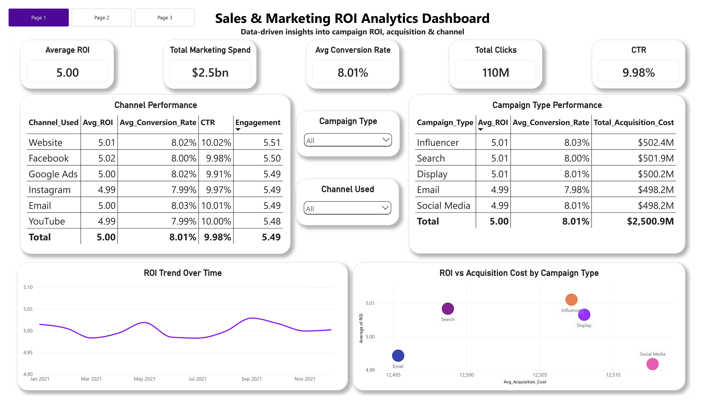
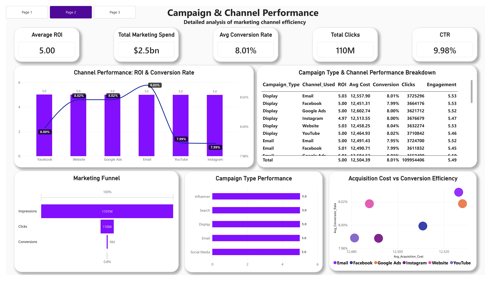
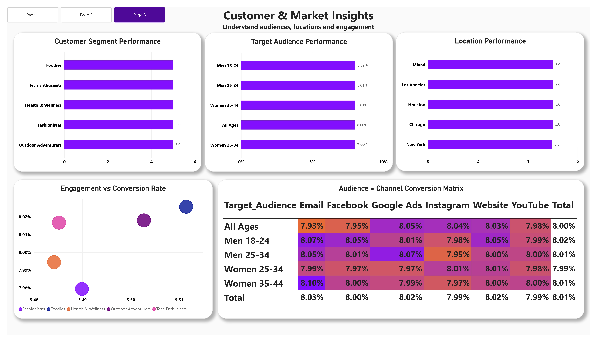
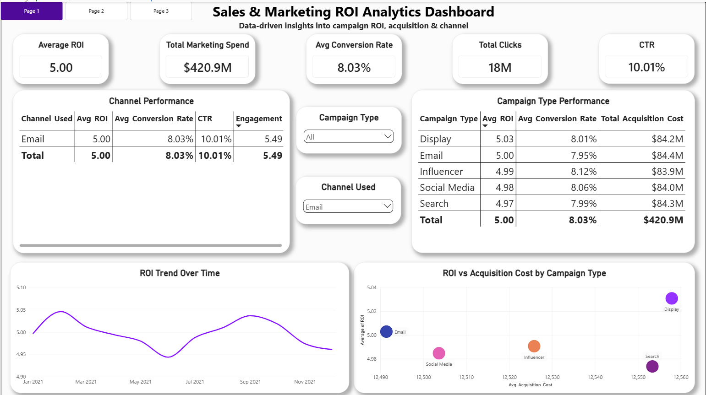
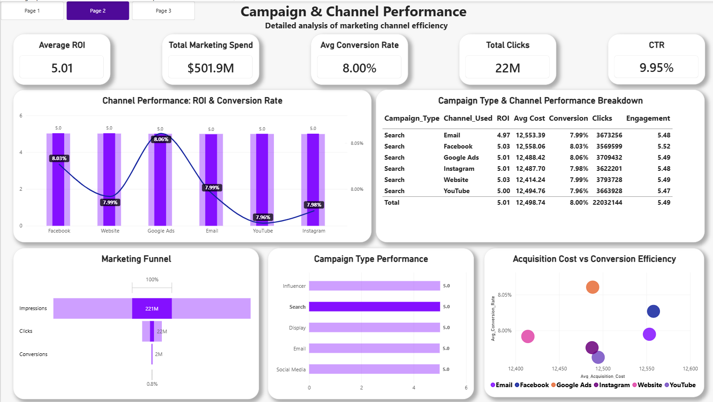

# Sales & Marketing ROI Analytics Dashboard

An interactive 3-page **Power BI** dashboard that analyzes campaign ROI, marketing spend, conversion rates, and channel performance across **200,000+ marketing campaign records**.

> Final-year project for the BCA program (Data Analytics specialization), Amity University Online.

---

## Problem Statement

Businesses spend marketing budget across several channels (social media, email, search, display, influencers) but often lack a clear, data-driven view of which channels, campaign types, and audiences actually perform. This leads to budget decisions based on intuition rather than evidence.

## Solution

A consolidated dashboard that turns raw campaign data into clear KPIs and comparisons, so performance can be reviewed by channel, campaign type, customer segment, audience, and location, with interactive filtering.

---

## Dashboard Preview

### Page 1: Executive Overview

### Page 2: Campaign & Channel Performance

### Page 3: Customer & Market Insights

### Interactive Filtering
| Page 1 filtered by Channel = Email | Page 2 filtered by Campaign Type = Search |
|---|---|
|  |  |

---

## Key Features

- **KPI cards:** Average ROI, Total Marketing Spend, Average Conversion Rate, Total Clicks, CTR
- **Channel and campaign type comparison** with ROI, conversion rate, CTR, and engagement
- **ROI trend over time** (monthly, 2021)
- **Marketing funnel:** Impressions to Clicks to Estimated Conversions
- **Customer segment, target audience, and location analysis**
- **Audience x Channel conversion matrix** with conditional formatting
- **Interactive slicers** (Campaign Type, Channel Used) and cross-filtering between visuals
- **Page navigation** across all three pages

---

## Tools & Technologies

| Area | Tool |
|---|---|
| Visualization & modeling | Power BI Desktop |
| Data cleaning | Power Query (M language) |
| Calculations | DAX |
| Data source | Kaggle: Marketing Campaign Performance Dataset (author: manishabhatt22) |

Dataset link: `https://www.kaggle.com/datasets/manishabhatt22/marketing-campaign-performance-dataset`

The dataset (200,000 rows, 16 columns) is not stored in this repository because of its size. Download it from Kaggle using the link above.

---

## Data Preparation (Power Query)

1. Loaded the CSV file (16 columns) and promoted headers
2. Assigned correct data types (integers, decimals, dates, text)
3. Cleaned `Acquisition_Cost` by removing `$` and `,` characters, then converting it from text to a decimal number
4. Checked `Campaign_ID` for duplicates (none found; all 200,000 rows are unique)
5. Verified that all columns had 0% errors and 0% empty values

The full M code is in [`Technical_Implementation.txt`](Technical_Implementation.txt).

---

## DAX Measures

| Measure | Purpose |
|---|---|
| `Avg_ROI` | Average ROI per campaign (average, not sum, because ROI is a ratio) |
| `Avg_Conversion_Rate` | Average conversion rate per campaign |
| `Avg_Acquisition_Cost` | Average cost per campaign |
| `Total_Acquisition_Cost` | Total spend (shown as "Total Marketing Spend") |
| `Total_Clicks` | Total number of clicks |
| `CTR` | Click-through rate = Total Clicks / Total Impressions |
| `Estimated_Conversions` | Sum of (Clicks x Conversion Rate) per row |
| `CAC` | Proxy customer acquisition cost = Total Spend / Estimated Conversions |

> **Note:** The dataset has no actual customer count, so `CAC` is a proxy based on estimated conversions.

Formulas for all measures are in [`Technical_Implementation.txt`](Technical_Implementation.txt).

---

## Key Insights

- **Overall:** 200,000 campaigns, $2.5bn total spend, 110M clicks, average ROI of 5.00, average conversion rate of 8.01%, and CTR of 9.98%.
- **Channels perform very similarly.** Average ROI ranges only from 4.99 to 5.02 across channels, so no channel is a clear winner.
- **Campaign types are also close.** Spend per type is between $498M and $502M, and conversion rates range from 7.98% to 8.03%.
- **The funnel shows where volume is lost.** About 10% of impressions become clicks, and overall only about 0.8% of impressions convert, so the upper funnel offers the most room for improvement.
- **Audience x channel conversion varies very little**, from 7.93% to 8.10%, which suggests random variation rather than a stable pattern.
- **Smaller slices look noisier.** Filtering to a single channel makes the ROI trend swing more than in the full dataset, a reminder that small samples are less reliable.

**Takeaway:** The dataset is highly uniform, so the dashboard is best read as a demonstration of an end-to-end analytics workflow (data cleaning, KPI design, segmentation, comparison, and interactive filtering). Channel-level budget decisions should be backed by controlled testing rather than by these small differences alone.

---

## Repository Contents

| File | Description |
|---|---|
| `Marketing_ROI_Dashboard.pbix` | Power BI dashboard file |
| `Marketing_ROI_Dashboard.pdf` | PDF export of all three pages |
| `Page1_Executive_Overview.jpg` | Page 1 screenshot |
| `Page2_Campaign_Channel.jpg` | Page 2 screenshot |
| `Page3_Customer_Market.jpg` | Page 3 screenshot |
| `Page1_Filtered_Email.png` | Page 1 with the Email filter applied |
| `Page2_Filtered_Search.png` | Page 2 with the Search filter applied |
| `Technical_Implementation.txt` | Power Query M code and DAX formulas |

## How to Open

1. Download `Marketing_ROI_Dashboard.pbix`
2. Open it in [Power BI Desktop](https://powerbi.microsoft.com/desktop/) (free)
3. If prompted, update the data source path to your local copy of the Kaggle CSV file and click **Refresh**

---

## Author

**Amit**
BCA (Final Year), Data Analytics specialization
Amity University Online, Noida, Uttar Pradesh
